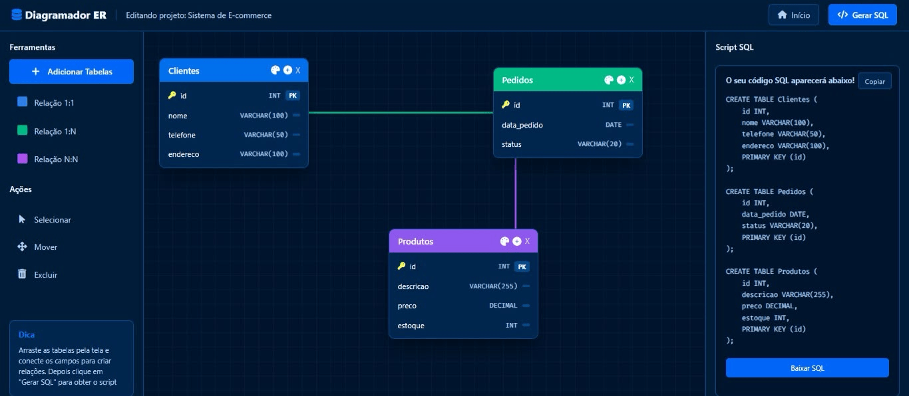

# Diagramador ER

O **Diagramador ER** é uma ferramenta web desenvolvida para facilitar a criação visual de diagramas de banco de dados (DER). Com ele, você pode organizar tabelas, definir colunas e estabelecer relacionamentos de forma simples e intuitiva, além de gerar automaticamente o código SQL correspondente ao seu projeto.

## Funcionalidades

* **Modelagem visual interativa:** adicione, mova e organize tabelas diretamente na tela.
* **Configuração de colunas:** defina nomes, tipos de dados (`INT`, `VARCHAR`, `DATE`, `DECIMAL`, entre outros) e chaves primárias (`PK`).
* **Relacionamentos:** conecte entidades visualmente com suporte a relações `1:1`, `1:N` e `N:N`.
* **Geração automática de SQL:** converta o diagrama em script SQL pronto para copiar ou baixar em arquivo.

## Tecnologias utilizadas

* **HTML5** — estrutura das páginas e elementos da interface.
* **CSS3** — estilização, tema escuro e organização visual do editor.
* **JavaScript** — lógica de manipulação das tabelas, conexões e geração do código SQL.
